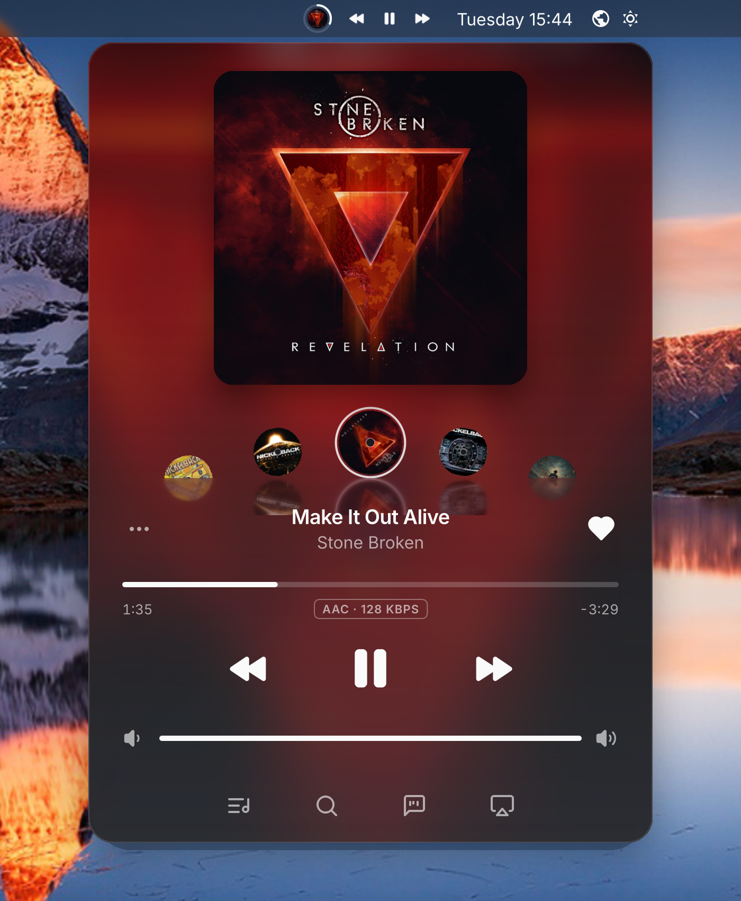
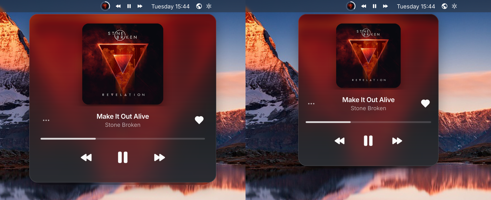
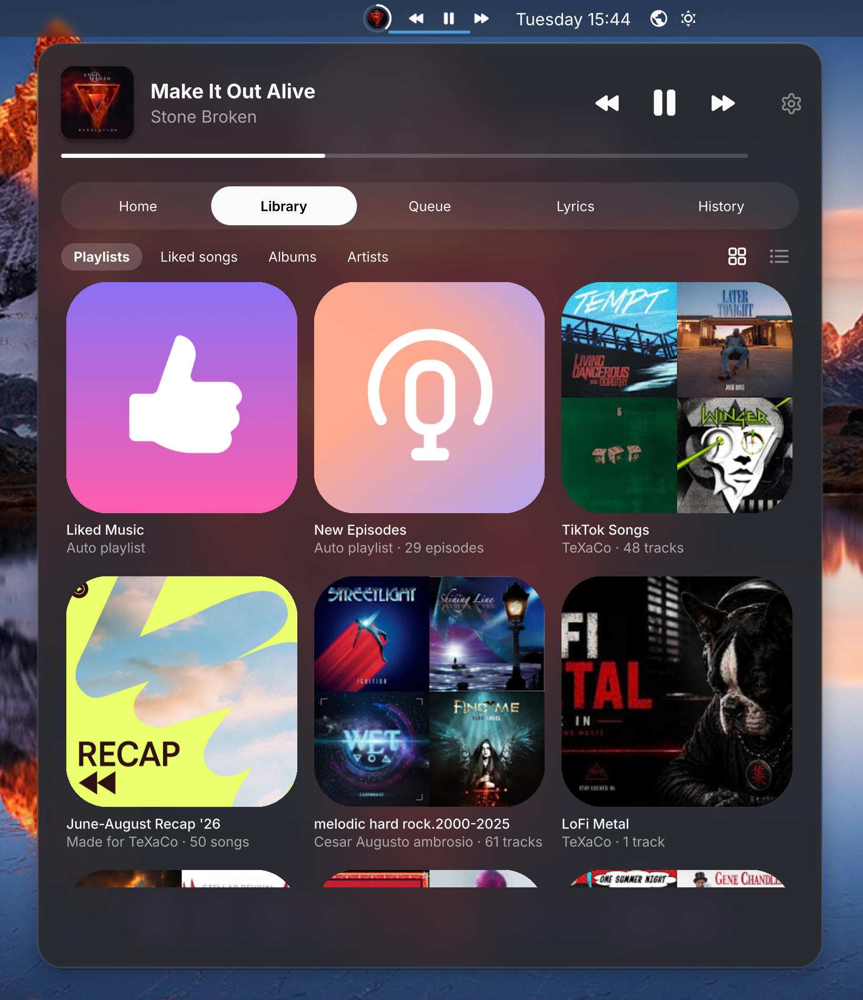
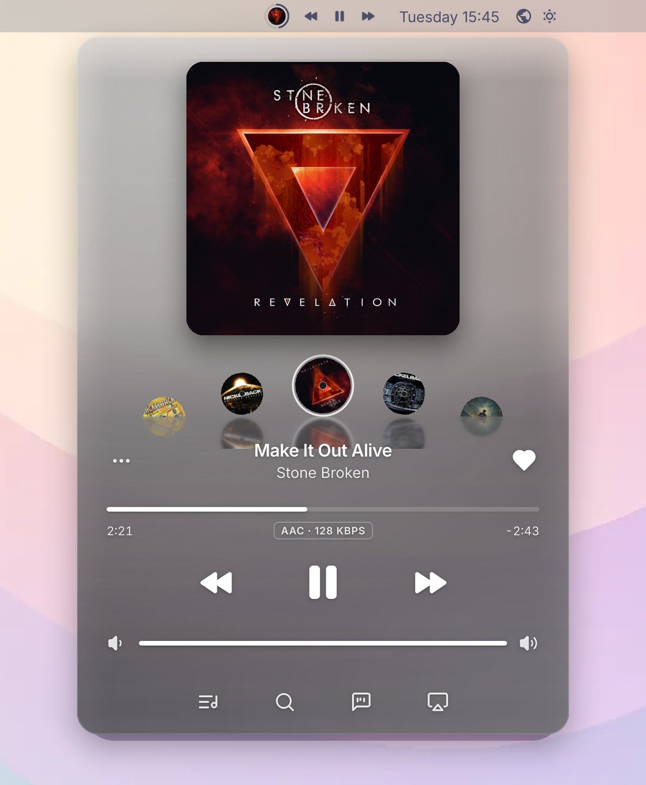

# Spinbloom

**YouTube Music for your Omarchy bar.** Discs that spin in, colours that bloom out.

Spinbloom puts YouTube Music in the Omarchy shell. A small round cover sits in your bar. Click it, and a frosted-glass player opens: a large cover with a wheel of CDs beneath it. Pick a song and its disc lifts off the wheel and slides into the player, and the album's colours bloom out across the glass.

Under the hood, the real YouTube Music web app runs hidden in its own browser profile. It never shows up on your screen and never takes focus. You sign in once, in a normal Google window.

<p align="center"></p>

## The idea

Spinbloom stands on the shoulders of [Solfa](https://github.com/SirAllap/omarchy-solfa) by SirAllap. Solfa did all of the hard work, the real YouTube Music, running quietly in the background and played from the Omarchy bar, with a library panel you can drive entirely from the keyboard.

Spinbloom builds on that wonderful work with the idea of a player that's familiar yet beautiful. It brings back a little nostalgia and the feeling of real music, of choosing a CD and watching it go in. The queue turns on a wheel of discs. A new song's disc lifts off and slides into the player. Then the album's colours bloom out across frosted glass. Everything Solfa does so well stays underneath, so it's still quick, light and keyboard-friendly. Spinbloom just gives it a face of its own.

## Features

- **The CD wheel.** Your queue sits under the cover as a wheel of discs. Scroll to turn it; click a disc to play it. When the song changes by itself, or you press Next, the new disc flies in too.
- **Colour that blooms.** Each song's artwork colours spread across the player as frosted glass. You can turn this off for a calm glass in your theme's own colour.
- **Three sizes.** Full, Compact (about half the height) and Small (narrower too), each with or without the CD wheel. Hover the player and click the corner button to step through them.
- **A full library.** Search, queue, your library and playlists, lyrics, and history, in a larger panel you can drive entirely from the keyboard.
- **Likes and playlists.** A heart with a swirl when you like a song, and a quieter one when you unlike it. Save any song to one of your playlists, or start a new playlist from it.
- **Radio, album and artist** from the ••• menu, plus **Copy song link** and **Not for me**.
- **Play music on…** Send just the music to another output (headphones, speakers, your TV) while the rest of your computer's sound stays put.
- **Sound.** A ten-band equalizer with presets, a preamp and a loudness leveller.
- **Sleep timer**, right in the ••• menu: 15 or 30 minutes, an hour, or the end of this song. The music fades out, then pauses.
- **Shortcuts** that never take a key another app is already using.
- **Follows your theme**, light or dark, and uses Hyprland's blur when you have it.

<p align="center"></p>
<p align="center"><em>Compact and Small</em></p>

<p align="center">
  
  
</p>
<p align="center"><em>The library panel, and the player on a light theme with album colours off</em></p>

## Requirements

- **Omarchy 4.5 or newer**, with shell plugins (`omarchy plugin --help` works). Spinbloom is built and tested on Omarchy 4.5; it hasn't been tried on earlier versions. Check yours with `omarchy version`.
- **A Chromium-based browser** in its usual place: Chromium (Omarchy's default), Google Chrome, Brave, Vivaldi or Microsoft Edge.
- **Python 3** (`/usr/bin/python3`), **Hyprland** and a `systemd --user` session. Omarchy has all three.

## Install

```bash
omarchy plugin add https://github.com/TeXaCoNy/spinbloom --enable
```

Spinbloom appears in your bar. Click it, then click **Sign in**. A Google window opens; sign in there, and Spinbloom closes the window and starts playing, signed in. Search and play also work without signing in, with adverts.

To update or remove it:

```bash
omarchy plugin update spinbloom
omarchy plugin remove spinbloom
```

Removing it also closes Spinbloom's hidden browser, removes its keyboard shortcuts, and, about two minutes later, deletes its data folders, including the sign-in. See [SECURITY.md](SECURITY.md) for exactly what it stores and where.

## Using it

**On the bar:**

| Action | Does |
|---|---|
| Left click | Opens or closes the player |
| Middle click | Play / pause |
| Right click | Next song |
| Scroll | Volume |
| Shift + scroll | Seek |

**In the player:** click the cover to play or pause. Click the title to see the song in its album or queue. Click the artist to open their page. The ••• menu has Radio, Save to playlist, Sleep timer, Go to album, Go to artist, Not for me, Copy song link and Settings. The buttons along the bottom open the Queue, Search, Lyrics and Play music on.

**Keyboard shortcuts** (anywhere on your desktop):

| Keys | Does | If that key is taken |
|---|---|---|
| Super + Alt + M | Open or close the player | Super + Shift + M, then Super + Ctrl + M |
| Super + Alt + P | Play / pause | Super + Shift + P, then Super + Ctrl + P |
| Super + Alt + N | Next song | Super + Alt + . |
| Super + Alt + B | Previous song | Super + Alt + V |
| Super + Alt + L | Like | Super + Alt + H |

Spinbloom never takes a key another app uses. You can turn all of them off in Settings → Keys. Media keys work too.

**In the library panel:** press `?` to see every key. The ones you'll use most are `/` search, `space` play/pause, `n` / `p` next/previous, `f` like, `e` play next, `a` add to queue, `R` radio, `1`–`5` switch tabs, and `Esc` to go back.

## Settings

Open them from the player's ••• menu, or with the gear in the library panel.

| Section | What's there |
|---|---|
| **Account** | Who's signed in, and whether it's Premium. Switch account, sign out, and turn Spinbloom on or off |
| **Sound** | Equalizer, presets, preamp, loudness leveller |
| **Playback** | Sleep timer, start paused or playing, volume at start, start with the shell |
| **Appearance** | Dial or Flow artwork, calm motion, colour from album artwork, desktop blur, player size, CD wheel in compact |
| **Bar and alerts** | Controls and title in the bar, title width, song-change notifications |
| **Keys** | Global shortcuts on or off, and the full key list |
| **Advanced** | Which browser runs the engine, memory limits, clear cache, erase engine data, reset settings |
| **About** | Version, engine version and credits |

**Calm motion** (in Appearance) replaces the flying discs, spinning covers and swirls with simple fades.

## Turning it off

Spinbloom keeps playing in the background until you turn it off. To turn it off, open **Settings → Account** and switch Spinbloom off. The bar then shows Spinbloom's name, dimmed; click it to turn Spinbloom back on.

From a terminal:

```bash
~/.config/omarchy/plugins/spinbloom/bin/spinbloom quit
```

## Adverts

Without Premium, YouTube Music plays adverts. Spinbloom presses an advert's own **Skip** button as soon as YouTube allows it. If you pick Brave as the engine's browser (Settings → Advanced), you can also let Brave's built-in ad blocker work. It's off by default because it adds background downloads and memory.

## Privacy and security

Spinbloom only connects to YouTube Music, Google sign-in and YouTube's image servers. It has no analytics or tracking, needs no admin rights, and never edits your Hyprland or other config files; its own settings live in its entry in Omarchy's `shell.json`. [SECURITY.md](SECURITY.md) lists everything it runs, stores and changes.

## For the curious

<details>
<summary>How it works</summary>

`bin/spinbloom-engine` (Python, standard library only) starts the hidden browser with its own profile. It talks to it over a private pipe (`--remote-debugging-pipe`, no network port) and serves the shell on a private Unix socket. `engine/agent.js` runs inside the YouTube Music page and reports every change. `Service.qml` keeps the state, and `BarWidget.qml`, `MiniPlayer2.qml` and `Panel2.qml` draw it. More detail is in [docs/design.md](docs/design.md).

The YouTube Music page slowly uses more memory the longer it's open. Spinbloom quietly swaps it for a fresh page between songs, or while paused, after 12 hours or once it passes a memory limit (both limits are in Settings → Advanced). Your queue, song, position, volume, repeat and shuffle all come back.

</details>

<details>
<summary>Command line</summary>

```bash
bin/spinbloom status | play-pause | next | prev | like | volume +5 | open | close | toggle | quit | events
```

</details>

<details>
<summary>Tests</summary>

```bash
tests/run-all.sh
```

These run the page parsers and agent in Node against made-up data, the engine against a fake browser, and the screens off-screen in Quickshell.

</details>

## Looking ahead

Spinbloom plays YouTube Music today, but the player was designed so that more could follow. These are ideas being explored, not promises:

- **More music services:** Spotify and Tidal, played in the same player with the same CD wheel and colour bloom.
- **Your own music:** playing straight from a folder on your computer, such as `~/Music`, with covers taken from your files.
- **Choosing a source:** switching between services and your own music from the player, with one queue and one look.

Ideas and suggestions are welcome: open an issue on the project's GitHub page.

## Credits and licence

Spinbloom is built on [Solfa](https://github.com/SirAllap/omarchy-solfa) by SirAllap, and keeps its MIT licence ([LICENSE](LICENSE)). The YouTube Music engine, sign-in and much of the library panel come from Solfa. Spinbloom adds the player design, the CD wheel and its motion, the colour bloom, frosted glass, compact sizes, the save-to-playlist picker, the like swirl and the output picker.

Spinbloom is an independent project. It isn't made by or connected with Google, YouTube or Omarchy.
